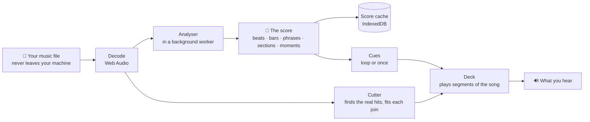
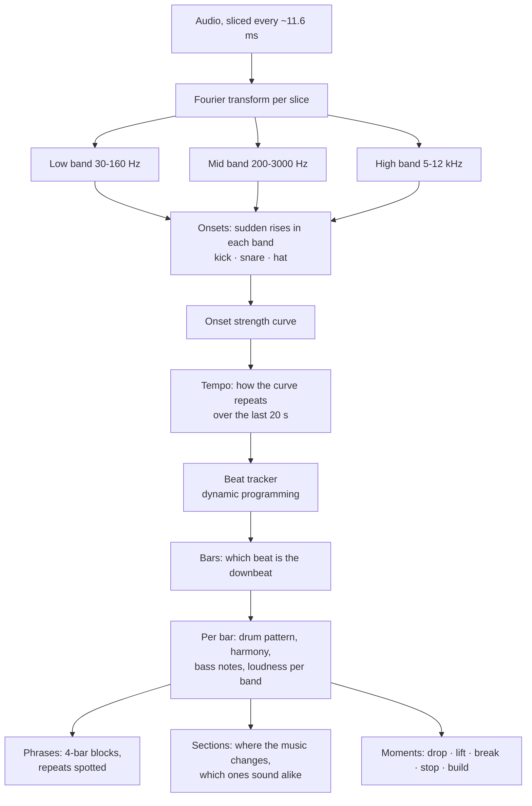
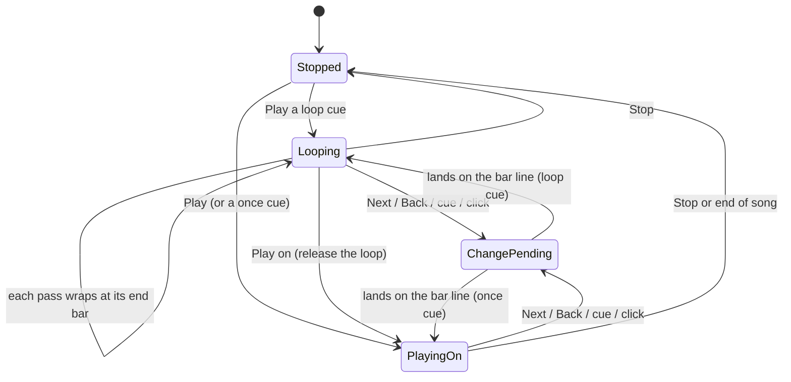
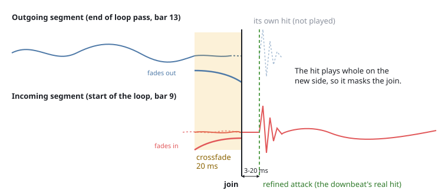
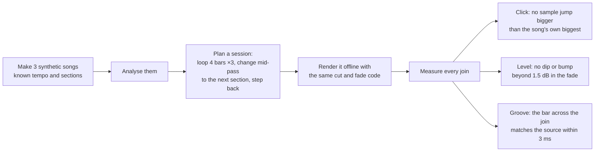

# How Vamper works

This is the plain-English tour: what happens between dropping a song and the music moving on at the table, which parts do what, and why. The diagrams render on GitHub. For a file-by-file reference see [ENGINE.md](ENGINE.md); for notes for coding agents see [AGENTS.md](../AGENTS.md).

## The big idea

A film composer writes music that waits for the picture. In a pit band the chart says **"vamp till ready"**: the band repeats a bar or two for as long as the scene needs, then everyone moves on together on the next bar. Game audio calls the same trick *horizontal re-sequencing*.

Vamper does this with any song you own. It **reads the song first** and writes down where every beat, bar, phrase and section is. Playback then becomes a list of instructions: "play bars 9 to 12, and again, and again; at the next bar line after the GM presses Next, jump to bar 25". Every jump is made at a spot chosen so the join can't be heard.



Everything runs in your browser: no server hears your music, nothing is uploaded, and it works offline once installed.

## Are there AI models in it?

No. There is **no neural network and no trained model** anywhere in Vamper. The analysis is classic signal processing (Fourier transforms, filters, pitch detection, dynamic programming), written in plain TypeScript. That is why it starts instantly, runs many times faster than real time on any machine, and gives the same answer every time for the same file.

The analyser comes from the [Gondryator](https://github.com/FrunkQ/gondryator), a music visualiser by the same author, which needed the same thing: a song turned into a timed score, ahead of playback. Have fun with this tech: [try the Gondryator](https://gondryator.starsystemx.com/), where any song becomes a ride and the world outside the window keeps time with the music.

## The journey of a song

```mermaid
sequenceDiagram
    participant You
    participant Page as Page (main.ts)
    participant L as Looper
    participant W as Analyser (worker)
    participant DB as Score cache

    You->>Page: drop a song
    Page->>L: load(file)
    L->>L: read tags (title, artist), hash the file
    L->>L: decode to audio, mix a mono copy
    L->>DB: seen this file before?
    alt cached
        DB-->>L: the finished score, at once
    else new song
        L->>W: analyse the mono audio
        loop every 3 s of audio
            W-->>L: more beats, bars, sections (only ever appended)
            L-->>Page: redraw; progress and time left
        end
        L->>DB: save the score
    end
    You->>Page: Play, Next, Back, click a section
    Page->>L: goTo(cue)
```

You can start playing before the analysis has finished. The score only ever grows (anything already found never changes), and the waveform is shaded beyond the point the analyser has reached.

## Listening: how the analyser hears a song

The analyser works on a mono copy, halved in sample rate until it is 30 kHz or less, cut into overlapping slices of 1024 samples every 256 samples (about every 11.6 ms). Each slice goes through a Fourier transform, which splits it into frequencies.



**Hits.** A drum hit is a sudden rise in energy. The analyser watches three bands: low (kick), mid (snare) and high (hats), and picks the peaks of each band's rise.

**Tempo and beats.** All the rises together make an *onset strength curve*. How often that curve repeats itself over the last 20 seconds gives the tempo. A beat tracker (the dynamic-programming method from Dan Ellis, 2007) then picks the actual beat times: it finds the chain of strong onsets that is most evenly spaced at that tempo. Beats are frozen as soon as they are certain, so they never move afterwards.

**Bars.** Bars are groups of four beats (the analyser assumes 4/4). Which beat is "one" is chosen from the evidence: where the kicks, bass notes and loudness changes tend to land. If that evidence moves consistently, the bar phase moves with it.

**What each bar sounds like.** For every bar the analyser records:
- a **drum grid**: kick, snare and hat on each of the 16 sixteenth notes;
- a **chroma**: how much of each of the 12 notes (C, C#, D...) is sounding, from a large Fourier transform per beat, which is the bar's harmony;
- the **bass notes**, from YIN pitch detection on the low band;
- the **loudness** of each band, and how busy the drums are.

**Phrases.** Music moves in blocks of four bars. Each phrase's bars are compared with every earlier phrase. If they are more than 90% alike, it is marked as a repeat and shares the earlier phrase's id.

**Sections.** At each bar, the analyser compares the next four bars with the four before. It looks at loudness, which bands are playing, harmony and drum density. A big enough change, judged against how restless this particular song is, starts a new section, preferably on a phrase boundary. Each section gets a label (intro, verse, chorus, breakdown, drop, outro), an energy level, and a **group**: sections that sound alike (more than 92.5% similar in groove, harmony, bass and band loudness) share a group, which Vamper shows as the same letter (A, B, C...).

**Moments.** Beat by beat, the analyser also notes sudden changes: a **drop** (a big step up, often the drums slamming back in), a **lift**, a **break** (the music thins out), a **stop** (near-silence) and a **build** (a crescendo). They help it name sections, and they are good places to change cue (see [Not yet](#not-yet)).

**How accurate is it?** It is accurate to the slice, about 11.6 ms. That is good enough to know where a bar is, but not good enough to cut audio: a cut 10 ms early or late is a stumble you can hear. On the synthetic test tracks the bar lines are off by up to 13 ms. That is why Vamper refines every cut against the audio itself (see [Blending](#blending-how-a-join-is-made)).

## Cues: what the music should do

A **cue** is a passage the music can sit in: a name, a start bar, an end bar, and a mode.

- **Loop** repeats the passage until you move on.
- **Once** plays from the passage's start and carries on through the song.

Until you make your own cues, every section is a cue (a loop), so a song is playable the moment it is analysed. You make a cue by dragging across bars and pressing **+ Cue**. Cues are saved in your browser, keyed by the song file's fingerprint, so they come back when you open the same file again.

In play you orchestrate: **Next** and **Back** step through the cues in order, number keys jump straight to one, and clicking a block on the strip goes there.

## Moving on: when a change lands

Pressing a button never cuts the music immediately. It asks for a change at the next **quantise point**:

| Setting | The change lands at |
|---|---|
| next beat | the next beat |
| next bar (default) | the next downbeat |
| next phrase | the start of the next 4-bar phrase |
| end of loop pass | when the current loop reaches its end |

The soonest a change can land is 120 ms after the press, which leaves time to schedule the audio precisely. The readout shows the countdown ("next change: Combat in 1.4 s"), and a yellow line on the waveform marks where it will land.



Two special cases are handled gently:
- If you choose a loop cue **while the music is already inside it**, nothing jumps: the music carries on and simply wraps at the cue's end.
- **Play on** releases a loop: the current pass carries straight on into the rest of the song, with no join at all.

## Playback: segments on a clock

The deck never "seeks". It plays the song as a chain of **segments**, each a stretch of the original recording from one sample to another. A loop playing three times, then a move to the breakdown, is four segments:

```mermaid
gantt
    dateFormat X
    axisFormat %s
    section What you hear
    Bars 9-12 (pass 1)    :a1, 0, 8
    Bars 9-12 (pass 2)    :a2, 8, 16
    Bars 9-10 (pass 3, cut at the bar line) :a3, 16, 20
    Breakdown from bar 25 :a4, 20, 36
```



Each segment is a Web Audio buffer source with its own volume control, started at an exact time on the audio clock (sample-accurate, independent of how busy the page is). The next segment is always queued 2.5 seconds ahead, so a slow or background tab can't make it late. When you ask for a change, the deck cancels anything queued that hasn't started, shortens the playing segment to end at the quantise point, and queues the new one.

## Blending: how a join is made

This is the heart of it. A join is where one segment hands over to the next. Getting it inaudible takes five steps, all in `src/engine/cuts.ts`.



**1. Find the real hit.** The analyser's bar line is only accurate to about 11.6 ms, so around each bar line Vamper looks at the full-quality audio, ±15 ms either side. It measures energy in 2 ms windows, every half a millisecond, and finds where it jumps most compared with the 5 ms before. A soft attack rises over several milliseconds, so it then walks back to where the rise begins. If nothing rises by at least 6 dB (a pad, a held chord), there is no hit to find, and the bar line is used as it is.

**2. Cut just before the hit.** The join sits a few milliseconds before the hit, in the small gap that almost every downbeat has. The hit then plays whole, from the new side, and a strong hit right after a join masks it (your ear is busy with the hit).

**3. Move both cuts together to the best spot.** Both sides are cut the same distance before their hits, somewhere between 3 and 20 ms. Within that range Vamper tries every half millisecond and picks the spot where the two sides of the crossfade are most alike (the smallest difference, sample by sample). That spot is usually either matching audio or a quiet moment. Because both cuts move by the same amount, the distance from the last beat to the next hit is unchanged, so **the groove doesn't stumble**.

**4. Crossfade for 20 ms, shaped by the material.** For 20 ms both sides play together, one fading out while the other fades in. The fade's shape depends on how alike the two sides are (their correlation):
- unrelated audio gets an **equal-power** fade (keeps the loudness steady when two different sounds mix);
- identical audio, such as a loop of bars that repeat exactly, gets an **equal-gain** fade (an equal-power fade would bump it 3 dB louder);
- audio that partly cancels gets a slight boost, so the level doesn't dip;
- anything in between gets a blend of these.

**5. Lengths come from the recording.** A loop is exactly the audio between two refined downbeats of this recording, never "four bars at 120 bpm". Real bands drift; a loop measured with a clock would slowly slide off the beat.

**Scoring each join.** For every join Vamper also measures how different "what would have followed" is from "what follows instead", as a loudness step over the next 80 ms. When a loop's wrap point steps by more than 3 dB (typically a reverb tail or a held note being cut off), it is flagged as likely to be heard: a red mark under the waveform, and ⚠ in the **Joins (debug)** list. For a change of section, a big step is just the music changing, so it isn't flagged.

## Proving it: the join test

Listening is the real test, but a computer can catch the obvious failures on every change to the code. `npm test` (also run by GitHub on every push) does this without a browser:



All 12 joins pass. The test does catch real mistakes: when a cut was deliberately moved by 4.5 ms, every join failed the groove check. It can't tell you how a join on a real song sounds. For that, listen and report the times from the **Joins (debug)** list ("change at 20.318 s clicks").

## The installable app

Vamper is a Progressive Web App: a web manifest, icons, and a service worker that caches the page so it opens offline. Install it from the browser's address bar or the **Install app** button. Songs are never fetched over the network, so the cache never holds your music. Scores (the analysis, not the audio) and cues are kept in your browser's own storage.

## Not yet

- **Riffing:** playing bars from a passage in a varied order, like a band vamping rather than a tape loop. The analyser already computes each bar's drum grid, harmony and bass notes. Riffing needs those exposed, plus a "which bar can follow which" graph.
- **Smarter change points:** using the analyser's moments, such as changing on a stop or riding a build into a combat cue.
- An AudioWorklet deck, grid repair (shift the downbeat, halve or double the tempo, drag a bar line), cue sheets as files, a big-button live mode, and playlists of songs.
