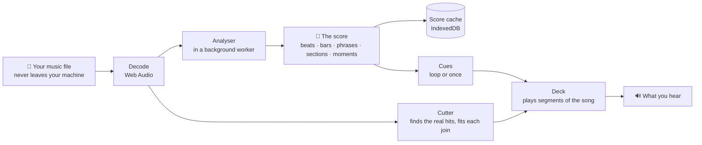
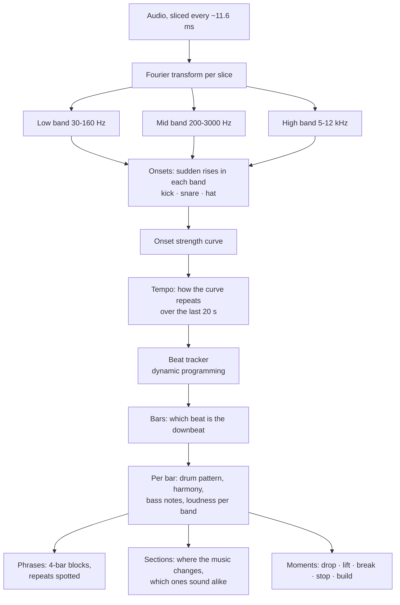
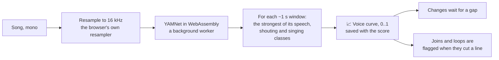
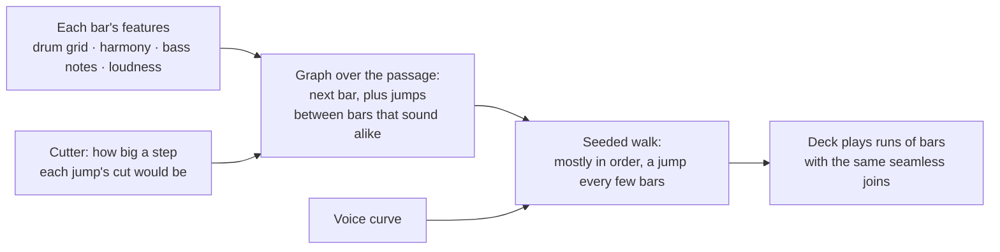
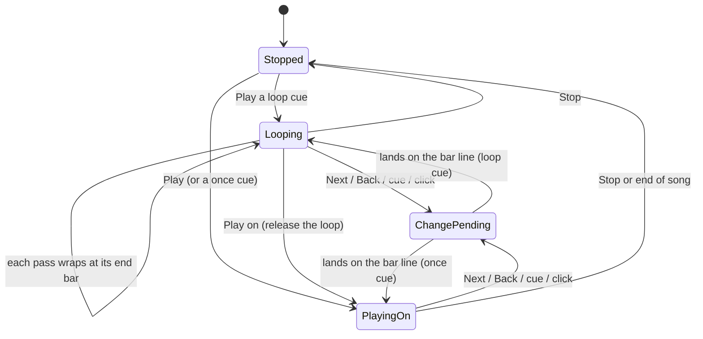
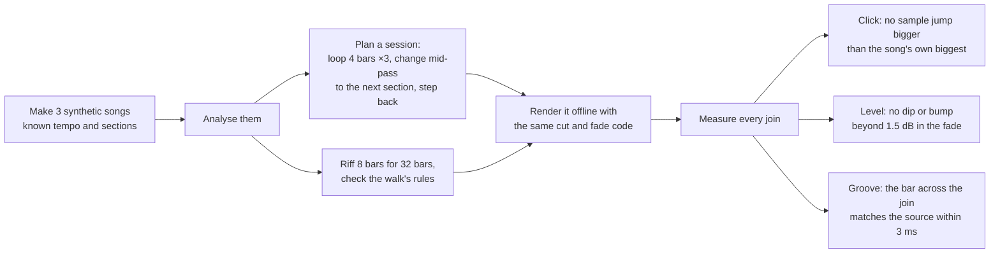
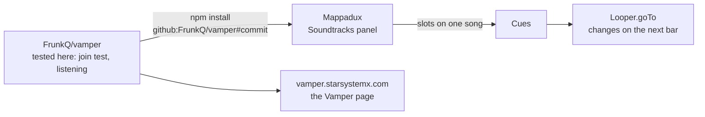

# How Vamper works

This is the plain-English tour: what happens between dropping a song and the music moving on at the table, which parts do what, and why. The diagrams render on GitHub. For a file-by-file reference see [ENGINE.md](ENGINE.md); for notes for coding agents see [AGENTS.md](../AGENTS.md).

## The big idea

A film composer writes music that waits for the picture. In a pit band the chart says **"vamp till ready"**: the band repeats a bar or two for as long as the scene needs, then everyone moves on together on the next bar. Game audio calls the same trick *horizontal re-sequencing*.

Vamper does this with any song you own. It **reads the song first** and writes down where every beat, bar, phrase and section is. Playback then becomes a list of instructions: "play bars 9 to 12, and again, and again; at the next bar line after the GM presses Next, jump to bar 25". Every jump is made at a spot chosen so the join can't be heard.



Everything runs in your browser: no server hears your music, nothing is uploaded, and it works offline once installed.

## Are there AI models in it?

One small one, and only for one job. The beats, bars, phrases and sections come from classic signal processing (Fourier transforms, filters, pitch detection, dynamic programming), written in plain TypeScript, with **no neural network**. That is why it starts instantly, runs many times faster than real time on any machine, and gives the same answer every time for the same file.

The exception is the **voice pass** (see [Listening for voices](#listening-for-voices)): Google's YAMNet, a sound classifier, listens for singing and talking so that a change doesn't cut a sung line in half. It runs in your browser too, after the main analysis, and the song plays while it listens.

The analyser comes from the [Gondryator](https://github.com/FrunkQ/gondryator), a music visualiser by the same author, which needed the same thing: a song turned into a timed score, ahead of playback. Have fun with this tech: [try the Gondryator](https://gondryator.starsystemx.com/), where any song becomes a ride and the world outside the window keeps time with the music.

## The journey of a song

```mermaid
sequenceDiagram
    participant You
    participant Page as Page (main.ts)
    participant L as Looper
    participant W as Analyser (worker)
    participant V as Voice pass (worker)
    participant DB as Score cache

    You->>Page: drop a song
    Page->>L: load(file)
    L->>L: read tags (title, artist), hash the file
    L->>L: decode to audio, mix a mono copy
    L->>DB: seen this file before?
    alt cached
        DB-->>L: the finished score, at once
    else new song
        L->>W: analyse the mono audio
        loop every 3 s of audio
            W-->>L: more beats, bars, sections (only ever appended)
            L-->>Page: redraw, with progress and time left
        end
        L->>DB: save the score
    end
    opt voice curve not cached yet
        L->>V: listen for singing and talking (YAMNet)
        loop every 6 s of audio
            V-->>L: voice curve so far
            L-->>Page: redraw; progress and time left
        end
        L->>DB: save the score with its voice curve
    end
    You->>Page: Play, Next, Back, click a section
    Page->>L: goTo(cue)
```

You can start playing before the analysis has finished. The score only ever grows (anything already found never changes), and the waveform is shaded beyond the point the analyser has reached.

## Listening: how the analyser hears a song

The analyser works on a mono copy, halved in sample rate until it is 30 kHz or less, cut into overlapping slices of 1024 samples every 256 samples (about every 11.6 ms). Each slice goes through a Fourier transform, which splits it into frequencies.



**Hits.** A drum hit is a sudden rise in energy. The analyser watches three bands: low (kick), mid (snare) and high (hats), and picks the peaks of each band's rise.

**Tempo and beats.** All the rises together make an *onset strength curve*. How often that curve repeats itself over the last 20 seconds gives the tempo. A beat tracker (the dynamic-programming method from Dan Ellis, 2007) then picks the actual beat times: it finds the chain of strong onsets that is most evenly spaced at that tempo. Beats are frozen as soon as they are certain, so they never move afterwards.

**Bars.** Bars are groups of four beats (the analyser assumes 4/4). Which beat is "one" is chosen from the evidence: where the kicks, bass notes and loudness changes tend to land. If that evidence moves consistently, the bar phase moves with it.

**What each bar sounds like.** For every bar the analyser records:
- a **drum grid**: kick, snare and hat on each of the 16 sixteenth notes;
- a **chroma**: how much of each of the 12 notes (C, C#, D...) is sounding, from a large Fourier transform per beat, which is the bar's harmony;
- the **bass notes**, from YIN pitch detection on the low band;
- the **loudness** of each band, and how busy the drums are.

These features also go into the score (as `bars`), so Vamper can tell which bars sound alike when it riffs (see [Riffing](#riffing-vamping-instead-of-looping)).

**Phrases.** Music moves in blocks of four bars. Each phrase's bars are compared with every earlier phrase. If they are more than 90% alike, it is marked as a repeat and shares the earlier phrase's id.

**Sections.** At each bar, the analyser compares the next four bars with the four before. It looks at loudness, which bands are playing, harmony and drum density. A big enough change, judged against how restless this particular song is, starts a new section, preferably on a phrase boundary. Each section gets a label (intro, verse, chorus, breakdown, drop, outro), an energy level, and a **group**: sections that sound alike (more than 92.5% similar in groove, harmony, bass and band loudness) share a group, which Vamper shows as the same letter (A, B, C...).

**Moments.** Beat by beat, the analyser also notes sudden changes: a **drop** (a big step up, often the drums slamming back in), a **lift**, a **break** (the music thins out), a **stop** (near-silence) and a **build** (a crescendo). They help it name sections, and they are good places to change cue (see [Not yet](#not-yet)).

**How accurate is it?** It is accurate to the slice, about 11.6 ms. That is good enough to know where a bar is, but not good enough to cut audio: a cut 10 ms early or late is a stumble you can hear. On the synthetic test tracks the bar lines are off by up to 13 ms. That is why Vamper refines every cut against the audio itself (see [Blending](#blending-how-a-join-is-made)).

## Listening for voices

A bar line is a fine place to cut a drum loop, but not the middle of a word. Singers phrase across bar lines all the time, so a change that lands on the next bar can chop a sung line in half. Vamper listens for voices so it can avoid that.



**What it is.** [YAMNet](https://github.com/tensorflow/models/tree/master/research/audioset/yamnet) is a small neural network from Google that recognises 521 kinds of sound (AudioSet's classes). Google's MediaPipe runs it in WebAssembly. Vamper keeps only its human-voice classes (speech, conversation, narration, shouting, singing, choir, rapping, humming...) and writes down, for each window of about a second, how sure it is that someone is singing or talking: the **voice curve**. It is the Gondryator's sound pass, cut down to just this curve.

**What it costs.** The model and its runtime are about 11 MB, fetched from the site the first time and then kept by the installed app, so it works offline. Listening is far faster than real time: on a laptop, a second or so to load the model (longer the first time, while it downloads) and then roughly 50 to 200 times real time, so a few seconds at most for a four-minute song. It starts **after** the main analysis and never holds anything up: the song is playable already, the progress bar says how long is left, and until the curve reaches a bar line changes there behave as they always did. The curve is saved with the score, so a song is only listened to once.

**How it changes a cut.** A cut at a bar line counts as splitting a line when the voice curve is above 0.3 on **both** sides of it (0.3 s before and after), so a line that ends just before the bar, or starts on it, is fine. When the next quantise point would split a line, the change may wait **up to two more bars** for one that doesn't. If every bar line in reach splits a line, it takes the least-bad one, counting a phrase start as a little better (a new vocal line usually starts on one). The readout says "(waiting for a gap in the vocal)" when that happens.

**What it shows.** The voice curve is drawn in pink along the bottom of the waveform, so you can see why a change waited. Every join in **Joins (debug)** lists its `voice` (the worse of its two sides; `?` until the pass has listened there), with 🎤 when it cuts a vocal, and a pink mark under the waveform. A loop cue whose wrap splits a line says "🎤 wrap cuts a vocal" in the cue list, because that will be heard on every pass: move its ends by a bar.

What it can't do: it hears *a voice*, not words, so it can't find the end of a sentence, and a breath between two words inside one window looks like singing throughout. With windows of about a second, it is a guide for which bar to cut at, not for where inside the bar. On instrumental music it hears nothing, and changes land exactly as before.

## Cues: what the music should do

A **cue** is a passage the music can sit in: a name, a start bar, an end bar, and a mode.

- **Loop** repeats the passage until you move on.
- **Riff** stays in the passage too, but plays its bars in a varied order, like a band vamping (see [Riffing](#riffing-vamping-instead-of-looping)).
- **Once** plays from the passage's start and carries on through the song.

Until you make your own cues, every section is a cue (a loop), so a song is playable the moment it is analysed. You make a cue by dragging across bars and pressing **+ Cue**. Cues are saved in your browser, keyed by the song file's fingerprint, so they come back when you open the same file again.

In play you orchestrate: **Next** and **Back** step through the cues in order, number keys jump straight to one, and clicking a block on the strip goes there.

## Riffing: vamping instead of looping

A loop is a tape: the same eight bars, in the same order, for as long as the scene lasts. Half an hour of exploring and the players can hum the wrap. A band vamping does something else: it stays in the same groove but goes round it differently, repeats a phrase, skips back to the turnaround, comes back to the top. A **riff** cue does that with the bars of its passage.



**Which bar can follow which.** Every bar can be followed by the next one (and the last by the first, as in a loop). Vamper also adds a **jump** from bar *i* to bar *j* when bar *j* sounds like the bar that would have come next, and the bar before *j* sounds like bar *i*: same drum pattern, same harmony, same bass notes, about as loud. Then the music lands where it might have been anyway. A jump also has to keep the place in the phrase (the third bar of a phrase only jumps to a third bar), so the music still breathes in fours, and the cut itself must not step in loudness by more than 3 dB, the same test that flags a rough loop wrap.

**How it walks.** Mostly in order. Every three to five bars it takes a jump if one fits, preferably where a phrase starts. It never takes the same jump twice running. It never jumps out of, or into, the middle of a sung line (the [voice curve](#listening-for-voices)). The choice is random but **seeded**: the same cue riffs the same way every time, from the song's fingerprint and where the cue starts, and the 🎲 button picks another riff for that cue.

**What you see.** The cue list says how many jumps the passage has ("8 jumps"), or that its bars are too different to jump between, in which case it plays as a plain loop. While it riffs, the readout lists the bars ("riffing ⤨ bars 13 14 11 12 13 14 15 16"), each jump draws a green arc over the waveform from where it left to where it landed, and **Joins (debug)** lists the whole path and every jump with its bars, how alike they are and the loudness step of its cut. Talk about a jump that sounds wrong by its bars ("12 → 9 stumbles").

Every jump is a join like any other, made with the same five steps below, so it should be as inaudible as a loop's wrap. What it can't know: whether a jump makes musical sense beyond sounding alike, such as jumping out of a guitar solo's build. That is what the listening tests are for.

## Moving on: when a change lands

Pressing a button never cuts the music immediately. It asks for a change at the next **quantise point**:

| Setting | The change lands at |
|---|---|
| next beat | the next beat |
| next bar (default) | the next downbeat |
| next phrase | the start of the next 4-bar phrase |
| end of loop pass | when the current loop reaches its end |

The soonest a change can land is 120 ms after the press, which leaves time to schedule the audio precisely. On a song with vocals it may wait up to two more bars rather than cut a sung line (see [Listening for voices](#listening-for-voices)). The readout shows the countdown ("next change: Combat in 1.4 s"), and a yellow line on the waveform marks where it will land.



Two special cases are handled gently:
- If you choose a loop cue **while the music is already inside it**, nothing jumps: the music carries on and simply wraps at the cue's end.
- **Play on** releases a loop: the current pass carries straight on into the rest of the song, with no join at all.

## Playback: segments on a clock

The deck never "seeks". It plays the song as a chain of **segments**, each a stretch of the original recording from one sample to another. A loop playing three times, then a move to the breakdown, is four segments:

```mermaid
gantt
    dateFormat X
    axisFormat %s
    section What you hear
    Bars 9-12 (pass 1)    :a1, 0, 8
    Bars 9-12 (pass 2)    :a2, 8, 16
    Bars 9-10 (pass 3, cut at the bar line) :a3, 16, 20
    Breakdown from bar 25 :a4, 20, 36
```



Each segment is a Web Audio buffer source with its own volume control, started at an exact time on the audio clock (sample-accurate, independent of how busy the page is). The next segment is always queued 2.5 seconds ahead, so a slow or background tab can't make it late. When you ask for a change, the deck cancels anything queued that hasn't started, shortens the playing segment to end at the quantise point, and queues the new one.

## Blending: how a join is made

This is the heart of it. A join is where one segment hands over to the next. Getting it inaudible takes five steps, all in `src/engine/cuts.ts`.


**1. Find the real hit.** The analyser's bar line is only accurate to about 11.6 ms, so around each bar line Vamper looks at the full-quality audio, ±15 ms either side. It measures energy in 2 ms windows, every half a millisecond, and finds where it jumps most compared with the 5 ms before. A soft attack rises over several milliseconds, so it then walks back to where the rise begins. If nothing rises by at least 6 dB (a pad, a held chord), there is no hit to find, and the bar line is used as it is.

**2. Cut just before the hit.** The join sits a few milliseconds before the hit, in the small gap that almost every downbeat has. The hit then plays whole, from the new side, and a strong hit right after a join masks it (your ear is busy with the hit).

**3. Move both cuts together to the best spot.** Both sides are cut the same distance before their hits, somewhere between 3 and 20 ms. Within that range Vamper tries every half millisecond and picks the spot where the two sides of the crossfade are most alike (the smallest difference, sample by sample). That spot is usually either matching audio or a quiet moment. Because both cuts move by the same amount, the distance from the last beat to the next hit is unchanged, so **the groove doesn't stumble**.

**4. Crossfade for 20 ms, shaped by the material.** For 20 ms both sides play together, one fading out while the other fades in. The fade's shape depends on how alike the two sides are (their correlation):
- unrelated audio gets an **equal-power** fade (keeps the loudness steady when two different sounds mix);
- identical audio, such as a loop of bars that repeat exactly, gets an **equal-gain** fade (an equal-power fade would bump it 3 dB louder);
- audio that partly cancels gets a slight boost, so the level doesn't dip;
- anything in between gets a blend of these.

**5. Lengths come from the recording.** A loop is exactly the audio between two refined downbeats of this recording, never "four bars at 120 bpm". Real bands drift; a loop measured with a clock would slowly slide off the beat.

**Scoring each join.** For every join Vamper also measures how different "what would have followed" is from "what follows instead", as a loudness step over the next 80 ms. When a loop's wrap point steps by more than 3 dB (typically a reverb tail or a held note being cut off), it is flagged as likely to be heard: a red mark under the waveform, and ⚠ in the **Joins (debug)** list. For a change of section, a big step is just the music changing, so it isn't flagged.

## Proving it: the join test

Listening is the real test, but a computer can catch the obvious failures on every change to the code. `npm test` (also run by GitHub on every push) does this without a browser:



All 12 joins pass. It then riffs on eight bars of each track for 32 bars and checks the walk: there are jumps, it takes some, at least half the bars follow the one before, no jump twice running, every jump keeps the place in the phrase, the same seed gives the same riff, and a sung line over the whole passage stops every jump. The riff's 24 joins are measured like the others and pass. It also checks the voice-aware choice of bar on a made-up voice curve: a line across the next two bar lines makes a change wait for the third, no voice means no wait, and waiting can be turned off. The test does catch real mistakes: when a cut was deliberately moved by 4.5 ms, every join failed the groove check. It can't tell you how a join on a real song sounds. For that, listen and report the times from the **Joins (debug)** list ("change at 20.318 s clicks").

## The installable app

Vamper is a Progressive Web App: a web manifest, icons, and a service worker that caches the page so it opens offline. Install it from the browser's address bar or the **Install app** button. Songs are never fetched over the network, so the cache never holds your music. Scores (the analysis, not the audio) and cues are kept in your browser's own storage.

## Inside other apps

The Vamper page is a thin layer: everything that hears, cuts and plays lives in the engine, behind one class, `Looper`. That makes the engine a library other apps can use. They install it **from this repository, pinned to a commit**, rather than copying files, so a fix tested here reaches them exactly and nothing drifts.



**Mappadux** is the first. Its Soundtracks panel has slots ("Tavern", "Combat"), and a slot can now hold a song from the GM's audio library. Every slot on the same song becomes a cue: the slot's Start and End become the passage (snapped to whole bars by `barSpan`), and Loop decides between `loop` and `once`. Picking another slot on the same song calls `goTo`, so the music changes on the next bar with the same seamless join as here. Picking a YouTube or Spotify slot still crossfades. The songs travel inside Mappadux's `.mappadux` packs; each device analyses a song once and caches the score.

What an app gets is the package entry, `src/index.ts`: `Looper` and the cue types, plus the bar helpers (`barSpan`, `snapToBar`, `barStarts`, `lastBar`, `sectionNames`). It is TypeScript source compiled by the app's own bundler, and a CI check compiles it under the strictest settings an app uses, so an engine change that would break an app fails here first. Exported names are added, never renamed. The README's "Use the engine in your own app" has the code.

A Foundry VTT module would work the same way: the GM's browser analyses, and every player's browser plays its own copy and changes on the same bar.

## Not yet

- **Riffs that follow the game:** a riff that leans toward its louder, busier bars as the tension rises, and back.
- **Smarter change points:** using the analyser's moments, such as changing on a stop or riding a build into a combat cue.
- An AudioWorklet deck, grid repair (shift the downbeat, halve or double the tempo, drag a bar line), cue sheets as files, a big-button live mode, and playlists of songs.
